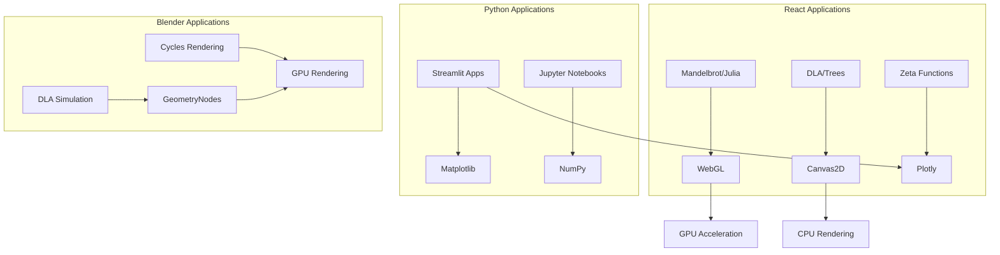

# Part VI: Interactive Applications

<a rel="license" href="http://creativecommons.org/licenses/by/4.0/"></a><br />This work is licensed under a <a rel="license" href="http://creativecommons.org/licenses/by/4.0/">Creative Commons Attribution 4.0 International License</a>.

This section provides access to interactive tools and demonstrations for exploring fractal mathematics and self-affine patterns. The applications are implemented in two frameworks:

- **React Applications**: High-performance web applications with GPU-accelerated visualization
- **Streamlit Applications**: Python-based interactive tools for scientific exploration

## Available Tools

### Fractal Visualizations

| Application | Framework | Description | Open |
|------------|-----------|-------------|------|
| [Mandelbrot Explorer](react-apps.md#mandelbrot-set) | React | Interactive Mandelbrot set visualization with zoom and parameter controls | [#/mandelbrot](https://tyson-swetnam.github.io/fractal-notebooks/react/#/mandelbrot) |
| [Julia Set Explorer](react-apps.md#julia-sets) | React | Real-time Julia set rendering with adjustable complex parameter | [#/julia](https://tyson-swetnam.github.io/fractal-notebooks/react/#/julia) |
| [Brownian Motion](react-apps.md#brownian-motion) | React | Random walk with a box-counting estimate of its fractal dimension | [#/brownian](https://tyson-swetnam.github.io/fractal-notebooks/react/#/brownian) |
| [Conway's Game of Life](react-apps.md#conways-game-of-life) | React | WebGL cellular automaton with colour schemes and cell-age shading | [#/conway](https://tyson-swetnam.github.io/fractal-notebooks/react/#/conway) |
| [Wave Dynamics](react-apps.md#waves-visualization) | React | Tidal and wave superposition with a noise term | [#/waves](https://tyson-swetnam.github.io/fractal-notebooks/react/#/waves) |
| [DLA Simulator](react-apps.md#diffusion-limited-aggregation) | React | Diffusion Limited Aggregation growth simulation | [#/dla](https://tyson-swetnam.github.io/fractal-notebooks/react/#/dla) |
| [Barnsley Fern](react-apps.md#barnsley-fern) | React | IFS-based fern generation | [#/ferns](https://tyson-swetnam.github.io/fractal-notebooks/react/#/ferns) |
| Fern Frond 3D | React | Three-dimensional fern frond | [#/fern-frond-3d](https://tyson-swetnam.github.io/fractal-notebooks/react/#/fern-frond-3d) |

### Tree and Branching Architectures

| Application | Framework | Description | Open |
|------------|-----------|-------------|------|
| [Pythagoras Tree](react-apps.md#pythagoras-tree) | React | Self-similar tree with adjustable branching angle | [#/pythagoras](https://tyson-swetnam.github.io/fractal-notebooks/react/#/pythagoras) |
| [Fractal Trees](react-apps.md#fractal-trees) | React | Recursive branching with selectable tree styles | [#/trees](https://tyson-swetnam.github.io/fractal-notebooks/react/#/trees) |
| [Plant Architecture Lab](react-apps.md#l-system-trees) | React | Lindenmayer system growth forms from bryophytes to vascular plants | [#/plant-lab](https://tyson-swetnam.github.io/fractal-notebooks/react/#/plant-lab) |
| [3D Tree/Root Visualization](tree-roots-3d.md) | React | Three-dimensional branching network visualization | [#/tree-roots-3d](https://tyson-swetnam.github.io/fractal-notebooks/react/#/tree-roots-3d) |

### 3D Simulation & Rendering

| Application | Framework | Description | Open |
|------------|-----------|-------------|------|
| [Blender DLA](blender-dla.md) | Blender/Python | 3D DLA simulation with Geometry Nodes and Cycles rendering | run locally |

### Analysis Tools

| Application | Framework | Description | Open |
|------------|-----------|-------------|------|
| [Differential Box-Counting](dbc.md) | Python | Calculate fractal dimensions of grayscale images | run locally |
| [Noise Patterns](react-apps.md#noise-generators) | React | White, pink and red noise with power spectra and fractal dimension | [#/noise](https://tyson-swetnam.github.io/fractal-notebooks/react/#/noise) |

### Mathematical Visualizations

| Application | Framework | Description | Open |
|------------|-----------|-------------|------|
| [Zeta Space Tiling](react-apps.md#riemann-zeta) | React | Bourke random tiling: circles, triangles and squares with areas A0 / i^c, summing to A0 ζ(c) | [#/zeta-space-tiling](https://tyson-swetnam.github.io/fractal-notebooks/react/#/zeta-space-tiling) |
| [3D Zeta Visualization](react-apps.md#riemann-zeta-3d) | React | Spheres, cubes and tetrahedra with volumes A0 / i^p packed without overlap in a cubic volume | [#/zeta-3d-visualization](https://tyson-swetnam.github.io/fractal-notebooks/react/#/zeta-3d-visualization) |

### Python Simulations (Streamlit)

| Application | Framework | Description | Open |
|------------|-----------|-------------|------|
| [Bacterial DLA and swarming](streamlit-apps.md) | Streamlit | Animated colony growth: Fujikawa–Matsushita DLA and Kawasaki reaction–diffusion models | run locally |
| [Physarum and yeast colonies](streamlit-apps.md) | Streamlit | Agent-based slime-mould network; D3.js force-directed yeast colony | run locally |
| [Tree rings and cambium](streamlit-apps.md) | Streamlit | Five linear-core and cambium growth simulators | run locally |
| [3D tree growth](streamlit-apps.md) | Streamlit | Cone-based growth simulator and tapered-cylinder crown + root models | run locally |

## Quick Start

### Running React Applications

The React applications are deployed and accessible online:

[**Launch Interactive Apps**](https://tyson-swetnam.github.io/fractal-notebooks/react/){ .md-button .md-button--primary }

Or run locally:

```bash
cd react
npm ci
npm start
```

### Running Streamlit Applications

```bash
cd apps
pip install streamlit numpy scipy matplotlib plotly pillow imageio
streamlit run tree_roots_3d.py
```

See [Streamlit Apps](streamlit-apps.md) for the full list of apps and the extra packages a few of them need.

## Technical Requirements

### For React Applications
- Modern web browser with WebGL support
- JavaScript enabled
- Recommended: Chrome, Firefox, or Safari

### For Python Applications
- Python 3.8+
- NumPy, SciPy, Matplotlib, Plotly
- Streamlit (for interactive apps)
- See [Installation Guide](installation.md) for full setup

## Application Architecture



## Contributing

To add new applications or improve existing ones:

1. **React apps**: Add new pages to `react/src/pages/`
2. **Streamlit apps**: Add new `.py` files to `apps/`
3. Follow the existing code patterns for consistency
4. Include documentation in this section
