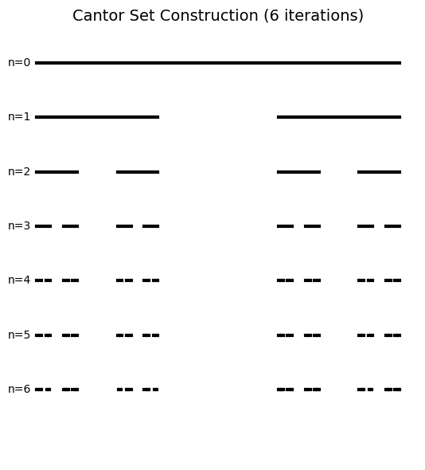
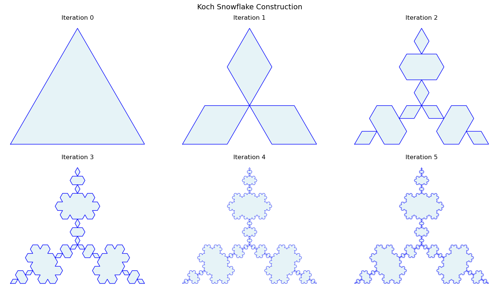
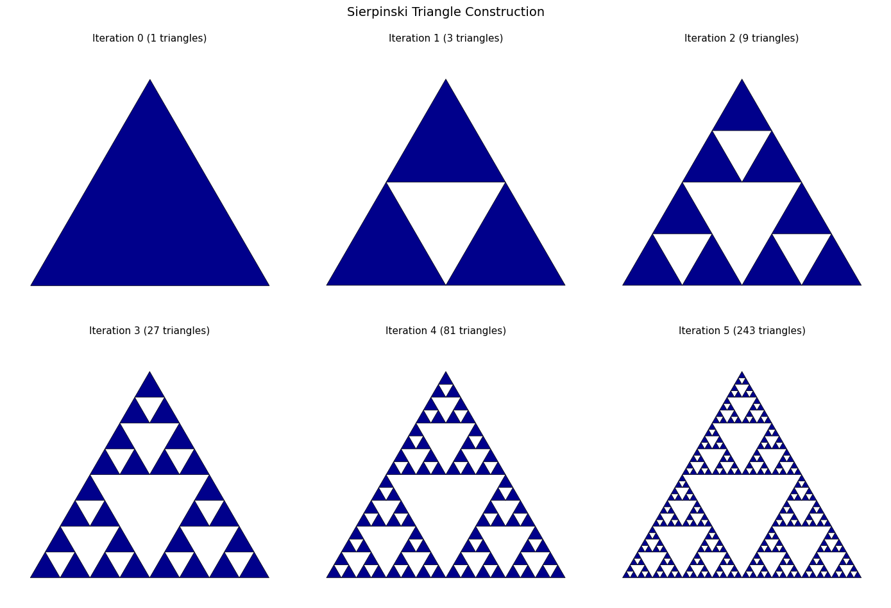
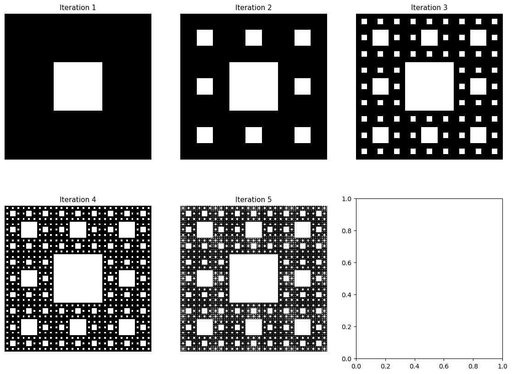
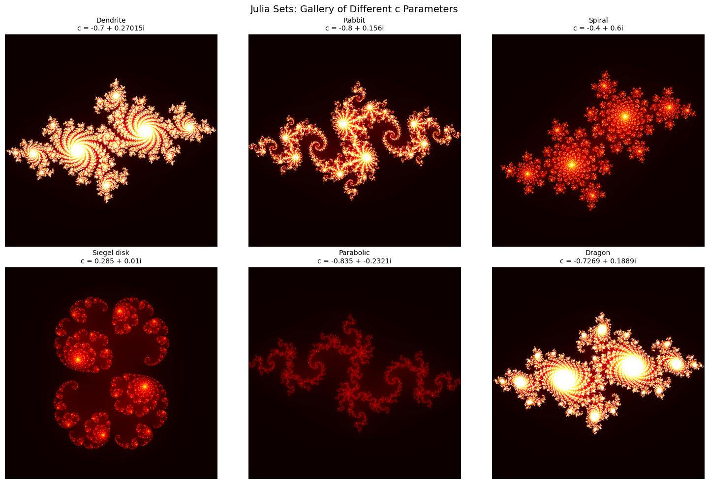
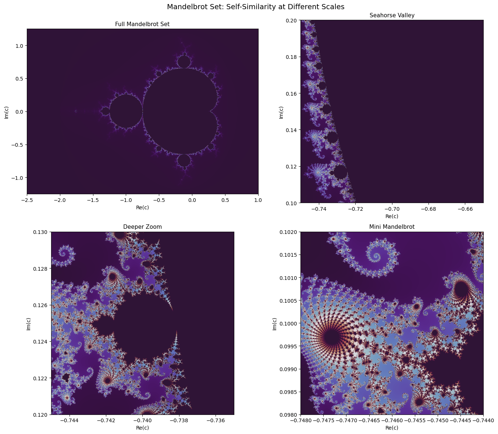

<!-- Generated by scripts/render_notebooks.py from the notebook named in the frontmatter. Do not edit: edit the .ipynb and re-run the script. -->

# Chapter 1: History of Fractal Mathematics

!!! info "Jupyter notebook"

    This page was rendered from the stored outputs of `1_history.ipynb` as of 2025-12-23; it is not executed at build time. 1 cell raised an error when the notebook was last run (ValueError).

    [View on GitHub](https://github.com/tyson-swetnam/fractal-notebooks/blob/main/docs/notebooks/foundations/1_history.ipynb) · [Open in nbviewer](https://nbviewer.org/github/tyson-swetnam/fractal-notebooks/blob/main/docs/notebooks/foundations/1_history.ipynb) · [Open in Colab](https://colab.research.google.com/github/tyson-swetnam/fractal-notebooks/blob/main/docs/notebooks/foundations/1_history.ipynb) · [Raw .ipynb](https://raw.githubusercontent.com/tyson-swetnam/fractal-notebooks/main/docs/notebooks/foundations/1_history.ipynb)

    Kernel: Python 3 (ipykernel) · Environment: environments/fractal-foundations-gpu.yml (runs on CPU: numpy, matplotlib, numba) · Companion page: [foundations/history/](https://tyson-swetnam.github.io/fractal-notebooks/foundations/history/)

This notebook provides interactive mathematical examples corresponding to the historical development of fractal geometry, from the "mathematical monsters" of the late 19th century to modern fractal theory.

**Topics covered:**
- Georg Cantor and the Cantor Set (1883)
- Helge von Koch and the Koch Snowflake (1904)
- Waclaw Sierpinski's Triangle and Carpet (1915-1916)
- Gaston Julia and Julia Sets (1918)
- Karl Weierstrass and Nowhere Differentiable Functions (1872)
- Benoit Mandelbrot and the Mandelbrot Set (1975-1980)


```python
import numpy as np
import matplotlib.pyplot as plt
from matplotlib.patches import Polygon
from matplotlib.collections import PatchCollection
from numba import jit, prange
import warnings
warnings.filterwarnings('ignore')

# Set default figure style
plt.rcParams['figure.figsize'] = [10, 8]
plt.rcParams['figure.dpi'] = 100
```

## 1.1 Georg Cantor and the Cantor Set (1883)

Georg Cantor, working on set theory and the continuum, introduced the **Cantor set** in 1883. The construction iteratively removes the middle third of each interval:

1. Begin with $[0, 1]$
2. Remove the open middle third $(1/3, 2/3)$, leaving $[0, 1/3] \cup [2/3, 1]$
3. Continue *ad infinitum*

**Properties:**
- **Measure zero**: Total length removed equals 1
- **Uncountably infinite**: Contains as many points as the real line
- **Fractal dimension**: $D = \frac{\log 2}{\log 3} \approx 0.631$


```python
def cantor_set(ax, x, y, length, depth, max_depth):
    """Draw the Cantor set recursively, showing all stages."""
    # Draw current segment
    ax.plot([x, x + length], [y, y], color='black', lw=3)
    
    if depth < max_depth:
        new_length = length / 3
        new_y = y - 0.15
        # Recurse on left and right thirds
        cantor_set(ax, x, new_y, new_length, depth + 1, max_depth)
        cantor_set(ax, x + 2 * new_length, new_y, new_length, depth + 1, max_depth)

# Visualize Cantor set construction
fig, ax = plt.subplots(figsize=(12, 6))
ax.set_title('Cantor Set Construction (6 iterations)', fontsize=14)
cantor_set(ax, 0, 1, 1, 0, 6)
ax.set_xlim(-0.05, 1.05)
ax.set_ylim(-0.1, 1.1)
ax.set_aspect('equal')
ax.axis('off')

# Add annotations
for i in range(7):
    ax.text(-0.08, 1 - i * 0.15, f'n={i}', fontsize=10, va='center')

# Calculate dimension
D_cantor = np.log(2) / np.log(3)
print(f"Cantor Set Fractal Dimension: D = log(2)/log(3) = {D_cantor:.4f}")
plt.tight_layout()
plt.show()
```

```text
Cantor Set Fractal Dimension: D = log(2)/log(3) = 0.6309
```





## 1.2 Helge von Koch and the Koch Snowflake (1904)

Swedish mathematician Helge von Koch constructed his curve in 1904 to demonstrate a continuous curve that is **nowhere differentiable**.

**Construction:**
1. Begin with a line segment
2. Replace the middle third with two sides of an equilateral triangle pointing outward
3. Repeat on every segment

**Properties:**
- **Infinite perimeter**: Each iteration multiplies length by $4/3$
- **Finite area**: Converges to $\frac{8}{5}$ times the original triangle
- **Fractal dimension**: $D = \frac{\log 4}{\log 3} \approx 1.262$


```python
def koch_curve(p1, p2, depth):
    """Generate Koch curve points between p1 and p2."""
    if depth == 0:
        return [p1, p2]
    
    # Calculate intermediate points
    dx = p2[0] - p1[0]
    dy = p2[1] - p1[1]
    
    # Points dividing the segment into thirds
    a = p1
    b = (p1[0] + dx/3, p1[1] + dy/3)
    d = (p1[0] + 2*dx/3, p1[1] + 2*dy/3)
    e = p2
    
    # Peak of the equilateral triangle
    # Rotate the middle third by 60 degrees
    cx = b[0] + dx/6 - dy * np.sqrt(3)/6
    cy = b[1] + dy/6 + dx * np.sqrt(3)/6
    c = (cx, cy)
    
    # Recurse on each segment
    points = []
    for seg in [(a, b), (b, c), (c, d), (d, e)]:
        pts = koch_curve(seg[0], seg[1], depth - 1)
        points.extend(pts[:-1])
    points.append(e)
    return points

def koch_snowflake(depth):
    """Generate a complete Koch snowflake."""
    # Start with equilateral triangle
    h = np.sqrt(3) / 2
    vertices = [(0, 0), (1, 0), (0.5, h)]
    
    all_points = []
    for i in range(3):
        p1 = vertices[i]
        p2 = vertices[(i + 1) % 3]
        points = koch_curve(p1, p2, depth)
        all_points.extend(points[:-1])
    all_points.append(all_points[0])  # Close the curve
    return all_points

# Visualize Koch curve evolution
fig, axes = plt.subplots(2, 3, figsize=(14, 8))
axes = axes.flatten()

for i, depth in enumerate(range(6)):
    points = koch_snowflake(depth)
    xs = [p[0] for p in points]
    ys = [p[1] for p in points]
    
    axes[i].plot(xs, ys, 'b-', lw=0.5 if depth > 3 else 1)
    axes[i].fill(xs, ys, alpha=0.3, color='lightblue')
    axes[i].set_title(f'Iteration {depth}', fontsize=12)
    axes[i].set_aspect('equal')
    axes[i].axis('off')

fig.suptitle('Koch Snowflake Construction', fontsize=14)

# Calculate dimension
D_koch = np.log(4) / np.log(3)
print(f"Koch Curve Fractal Dimension: D = log(4)/log(3) = {D_koch:.4f}")
print(f"Each iteration multiplies perimeter by 4/3 = {4/3:.4f}")
plt.tight_layout()
plt.show()
```

```text
Koch Curve Fractal Dimension: D = log(4)/log(3) = 1.2619
Each iteration multiplies perimeter by 4/3 = 1.3333
```





## 1.3 Waclaw Sierpinski: Triangle and Carpet (1915-1916)

Polish mathematician Waclaw Sierpinski introduced two fundamental fractals.

### Sierpinski Triangle
- **Construction**: Remove central inverted triangle from each remaining triangle
- **$N = 3$** copies at scale $r = 1/2$
- **Dimension**: $D = \frac{\log 3}{\log 2} \approx 1.585$

### Sierpinski Carpet
- **Construction**: Divide square into $3 \times 3$ grid, remove center
- **$N = 8$** copies at scale $r = 1/3$
- **Dimension**: $D = \frac{\log 8}{\log 3} \approx 1.893$


```python
def sierpinski_triangle(ax, vertices, depth, patches):
    """Generate Sierpinski triangle recursively."""
    if depth == 0:
        triangle = Polygon(vertices, closed=True)
        patches.append(triangle)
    else:
        # Calculate midpoints
        midpoints = [(vertices[i] + vertices[(i + 1) % 3]) / 2 for i in range(3)]
        # Recurse on three corner triangles
        sierpinski_triangle(ax, np.array([vertices[0], midpoints[0], midpoints[2]]), depth-1, patches)
        sierpinski_triangle(ax, np.array([vertices[1], midpoints[1], midpoints[0]]), depth-1, patches)
        sierpinski_triangle(ax, np.array([vertices[2], midpoints[2], midpoints[1]]), depth-1, patches)

# Visualize Sierpinski triangle evolution
fig, axes = plt.subplots(2, 3, figsize=(14, 10))
axes = axes.flatten()

vertices = np.array([[0, 0], [1, 0], [0.5, np.sqrt(3)/2]])

for i, depth in enumerate(range(6)):
    patches = []
    sierpinski_triangle(axes[i], vertices, depth, patches)
    collection = PatchCollection(patches, facecolor='darkblue', edgecolor='black', linewidth=0.5)
    axes[i].add_collection(collection)
    axes[i].set_title(f'Iteration {depth} ({3**depth} triangles)', fontsize=11)
    axes[i].set_xlim(-0.1, 1.1)
    axes[i].set_ylim(-0.1, 1)
    axes[i].set_aspect('equal')
    axes[i].axis('off')

fig.suptitle('Sierpinski Triangle Construction', fontsize=14)

D_sierpinski = np.log(3) / np.log(2)
print(f"Sierpinski Triangle Dimension: D = log(3)/log(2) = {D_sierpinski:.4f}")
plt.tight_layout()
plt.show()
```

```text
Sierpinski Triangle Dimension: D = log(3)/log(2) = 1.5850
```





```python
def sierpinski_carpet(depth, size=243):
    """Generate Sierpinski carpet as a binary image."""
    # Use size that's a power of 3 for clean division
    carpet = np.ones((size, size), dtype=bool)
    
    def remove_center(x, y, s):
        """Recursively remove center squares."""
        if s < 3:
            return
        third = s // 3
        # Remove center square
        carpet[y + third:y + 2*third, x + third:x + 2*third] = False
        # Recurse on 8 surrounding squares
        for dy in range(3):
            for dx in range(3):
                if dx == 1 and dy == 1:
                    continue  # Skip center
                remove_center(x + dx*third, y + dy*third, third)
    
    for d in range(depth):
        step = size // (3 ** (d + 1))
        for y in range(0, size, step * 3):
            for x in range(0, size, step * 3):
                carpet[y + step:y + 2*step, x + step:x + 2*step] = False
    
    return carpet

# Visualize Sierpinski carpet evolution
fig, axes = plt.subplots(2, 3, figsize=(14, 10))
axes = axes.flatten()

for i, depth in enumerate(range(1, 7)):
    carpet = sierpinski_carpet(depth)
    axes[i].imshow(carpet, cmap='binary', interpolation='nearest')
    axes[i].set_title(f'Iteration {depth}', fontsize=11)
    axes[i].axis('off')

fig.suptitle('Sierpinski Carpet Construction', fontsize=14)

D_carpet = np.log(8) / np.log(3)
print(f"Sierpinski Carpet Dimension: D = log(8)/log(3) = {D_carpet:.4f}")
plt.tight_layout()
plt.show()
```

!!! failure "Cell raised ValueError"

    range() arg 3 must not be zero





## 1.4 Karl Weierstrass: Continuous but Nowhere Differentiable (1872)

Weierstrass constructed a function that is continuous everywhere but differentiable nowhere:

$$W(x) = \sum_{n=0}^{\infty} a^n \cos(b^n \pi x)$$

where $0 < a < 1$, $b$ is an odd integer, and $ab > 1 + \frac{3\pi}{2}$.

These "pathological" functions were essential precursors to fractal geometry—they showed that mathematical objects need not be smooth.


```python
def weierstrass(x, a=0.5, b=7, n_terms=50):
    """Compute the Weierstrass function.
    
    Parameters:
    - a: amplitude decay (0 < a < 1)
    - b: frequency multiplier (odd integer)
    - n_terms: number of terms in the series
    """
    result = np.zeros_like(x)
    for n in range(n_terms):
        result += (a ** n) * np.cos((b ** n) * np.pi * x)
    return result

# Visualize Weierstrass function at different scales
fig, axes = plt.subplots(2, 2, figsize=(14, 10))

# Different zoom levels
ranges = [(0, 2), (0, 0.5), (0, 0.1), (0, 0.02)]
titles = ['Full view [0, 2]', 'Zoom [0, 0.5]', 'Zoom [0, 0.1]', 'Zoom [0, 0.02]']

for ax, (x_min, x_max), title in zip(axes.flatten(), ranges, titles):
    x = np.linspace(x_min, x_max, 5000)
    y = weierstrass(x, a=0.5, b=7)
    ax.plot(x, y, 'b-', lw=0.5)
    ax.set_title(f'Weierstrass Function: {title}', fontsize=11)
    ax.set_xlabel('x')
    ax.set_ylabel('W(x)')
    ax.grid(True, alpha=0.3)

fig.suptitle('Weierstrass Function: Continuous but Nowhere Differentiable\n(a=0.5, b=7)', fontsize=14)
plt.tight_layout()
plt.show()

# The fractal dimension relates to parameters
a, b = 0.5, 7
D_weierstrass = 2 + np.log(a) / np.log(b)
print(f"Weierstrass function graph dimension: D ≈ 2 + log(a)/log(b) = {D_weierstrass:.4f}")
```

## 1.5 Gaston Julia and Julia Sets (1918)

French mathematician Gaston Julia studied iteration of rational functions in the complex plane. For a quadratic polynomial $f_c(z) = z^2 + c$:

- The **filled Julia set** $K_c$ is the set of complex numbers $z$ whose iterates remain bounded
- The **Julia set** $J_c$ is the boundary of $K_c$

**Key result:** Julia sets are connected when $c$ is in the Mandelbrot set, and totally disconnected (Cantor-like dust) otherwise.


```python
@jit(nopython=True, parallel=True)
def compute_julia(c_real, c_imag, x_min, x_max, y_min, y_max, width, height, max_iter):
    """Compute Julia set using escape-time algorithm."""
    result = np.zeros((height, width))
    
    for j in prange(height):
        for i in range(width):
            # Map pixel to complex plane
            x = x_min + (x_max - x_min) * i / width
            y = y_min + (y_max - y_min) * j / height
            
            # Iterate z -> z^2 + c
            zx, zy = x, y
            iteration = 0
            
            while zx*zx + zy*zy < 4 and iteration < max_iter:
                xtemp = zx*zx - zy*zy + c_real
                zy = 2*zx*zy + c_imag
                zx = xtemp
                iteration += 1
            
            result[j, i] = iteration
    
    return result

# Gallery of Julia sets with different c values
fig, axes = plt.subplots(2, 3, figsize=(15, 10))
axes = axes.flatten()

# Famous Julia set parameters
c_values = [
    (-0.7, 0.27015, "Dendrite"),
    (-0.8, 0.156, "Rabbit"),
    (-0.4, 0.6, "Spiral"),
    (0.285, 0.01, "Siegel disk"),
    (-0.835, -0.2321, "Parabolic"),
    (-0.7269, 0.1889, "Dragon")
]

for ax, (c_re, c_im, name) in zip(axes, c_values):
    julia = compute_julia(c_re, c_im, -1.5, 1.5, -1.5, 1.5, 600, 600, 256)
    ax.imshow(julia, cmap='hot', extent=[-1.5, 1.5, -1.5, 1.5])
    ax.set_title(f'{name}\nc = {c_re} + {c_im}i', fontsize=10)
    ax.axis('off')

fig.suptitle('Julia Sets: Gallery of Different c Parameters', fontsize=14)
plt.tight_layout()
plt.show()
```





## 1.6 Benoit Mandelbrot and the Mandelbrot Set (1975-1980)

Mandelbrot recognized that "pathological" constructions were not aberrations but the geometric language of natural complexity. He coined "fractal" in 1975.

The **Mandelbrot set** $\mathcal{M}$ consists of all parameters $c$ for which the orbit of $z = 0$ under $f_c(z) = z^2 + c$ remains bounded:

$$\mathcal{M} = \{c \in \mathbb{C} : |f_c^n(0)| \not\to \infty \}$$

**Properties:**
- The boundary has Hausdorff dimension 2
- Contains infinitely many scaled copies of itself
- Connected despite its intricate boundary


```python
@jit(nopython=True, parallel=True)
def compute_mandelbrot(x_min, x_max, y_min, y_max, width, height, max_iter):
    """Compute Mandelbrot set using escape-time algorithm."""
    result = np.zeros((height, width))
    
    for j in prange(height):
        for i in range(width):
            # Map pixel to complex plane (c value)
            c_real = x_min + (x_max - x_min) * i / width
            c_imag = y_min + (y_max - y_min) * j / height
            
            # Iterate z -> z^2 + c starting from z = 0
            zx, zy = 0.0, 0.0
            iteration = 0
            
            while zx*zx + zy*zy < 4 and iteration < max_iter:
                xtemp = zx*zx - zy*zy + c_real
                zy = 2*zx*zy + c_imag
                zx = xtemp
                iteration += 1
            
            result[j, i] = iteration
    
    return result

# Full Mandelbrot set
fig, axes = plt.subplots(2, 2, figsize=(14, 12))

# Different zoom levels showing self-similarity
regions = [
    ((-2.5, 1.0, -1.25, 1.25), "Full Mandelbrot Set"),
    ((-0.75, -0.65, 0.1, 0.2), "Seahorse Valley"),
    ((-0.745, -0.735, 0.12, 0.13), "Deeper Zoom"),
    ((-0.748, -0.744, 0.098, 0.102), "Mini Mandelbrot")
]

for ax, ((x_min, x_max, y_min, y_max), title) in zip(axes.flatten(), regions):
    mandelbrot = compute_mandelbrot(x_min, x_max, y_min, y_max, 800, 800, 500)
    ax.imshow(mandelbrot, cmap='twilight_shifted', extent=[x_min, x_max, y_min, y_max])
    ax.set_title(title, fontsize=11)
    ax.set_xlabel('Re(c)')
    ax.set_ylabel('Im(c)')

fig.suptitle('Mandelbrot Set: Self-Similarity at Different Scales', fontsize=14)
plt.tight_layout()
plt.show()

print("The Mandelbrot set boundary has Hausdorff dimension = 2")
print("Small copies of the entire set appear at every scale.")
```





```text
The Mandelbrot set boundary has Hausdorff dimension = 2
Small copies of the entire set appear at every scale.
```

## Summary: Fractal Dimensions of Classical Examples

| Fractal | Year | $N$ copies | Scale $r$ | Dimension Formula | Value |
|---------|------|-----------|-----------|------------------|-------|
| Cantor Set | 1883 | 2 | 1/3 | $\log 2 / \log 3$ | 0.631 |
| Koch Curve | 1904 | 4 | 1/3 | $\log 4 / \log 3$ | 1.262 |
| Sierpinski Triangle | 1915 | 3 | 1/2 | $\log 3 / \log 2$ | 1.585 |
| Sierpinski Carpet | 1916 | 8 | 1/3 | $\log 8 / \log 3$ | 1.893 |
| Mandelbrot Boundary | 1980 | - | - | - | 2.000 |


```python
# Calculate and display all dimensions
fractals = [
    ("Cantor Set", 2, 3, 1883),
    ("Koch Curve", 4, 3, 1904),
    ("Sierpinski Triangle", 3, 2, 1915),
    ("Sierpinski Carpet", 8, 3, 1916),
]

print("Self-Similar Fractal Dimensions: D = log(N) / log(1/r)")
print("=" * 60)
print(f"{'Fractal':<25} {'Year':>6} {'N':>4} {'1/r':>5} {'Dimension':>12}")
print("-" * 60)

for name, N, inv_r, year in fractals:
    D = np.log(N) / np.log(inv_r)
    print(f"{name:<25} {year:>6} {N:>4} {inv_r:>5} {D:>12.4f}")

print("=" * 60)
```

```text
Self-Similar Fractal Dimensions: D = log(N) / log(1/r)
============================================================
Fractal                     Year    N   1/r    Dimension
------------------------------------------------------------
Cantor Set                  1883    2     3       0.6309
Koch Curve                  1904    4     3       1.2619
Sierpinski Triangle         1915    3     2       1.5850
Sierpinski Carpet           1916    8     3       1.8928
============================================================
```

## Further Reading

- Mandelbrot, B. B. *The Fractal Geometry of Nature*. W. H. Freeman, 1982.
- Falconer, Kenneth. *Fractal Geometry: Mathematical Foundations and Applications*. 3rd ed., Wiley, 2014.
- Peitgen, H.-O. and Richter, P. H. *The Beauty of Fractals*. Springer, 1986.

**Next:** See `2_mathematics.ipynb` for computational methods (box-counting, Hurst exponent, lacunarity).
