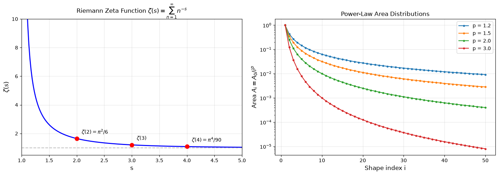
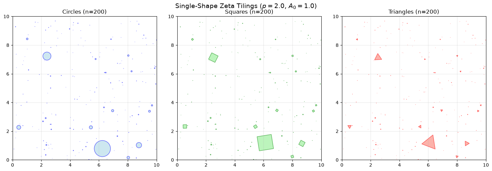
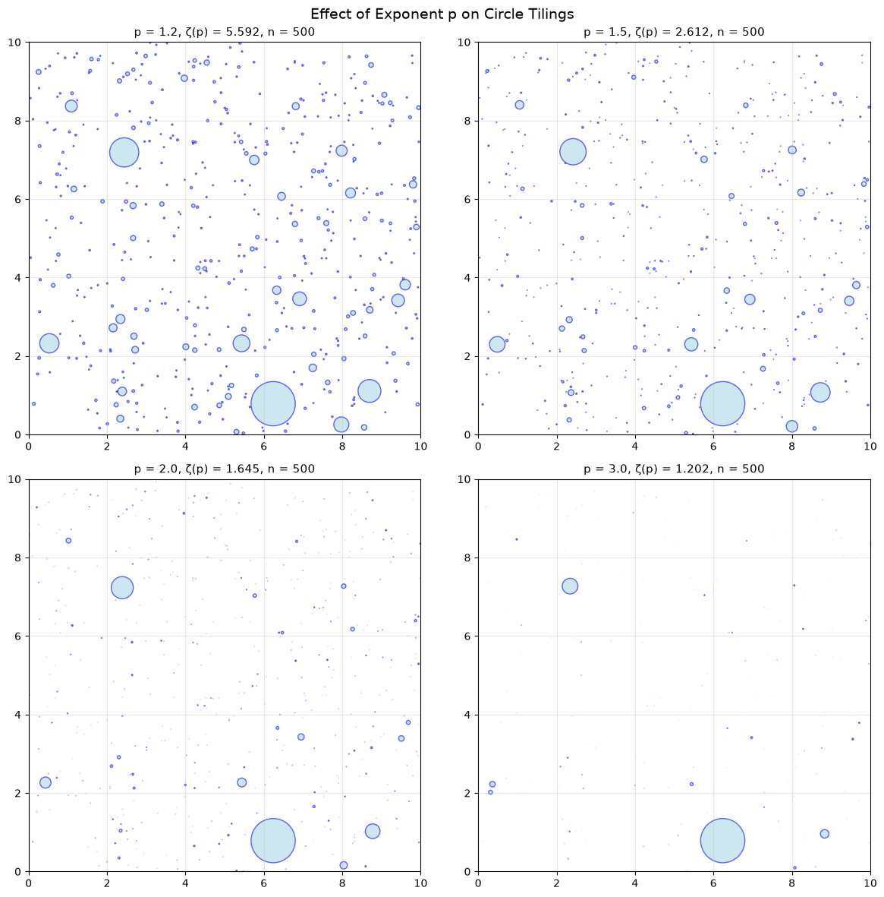
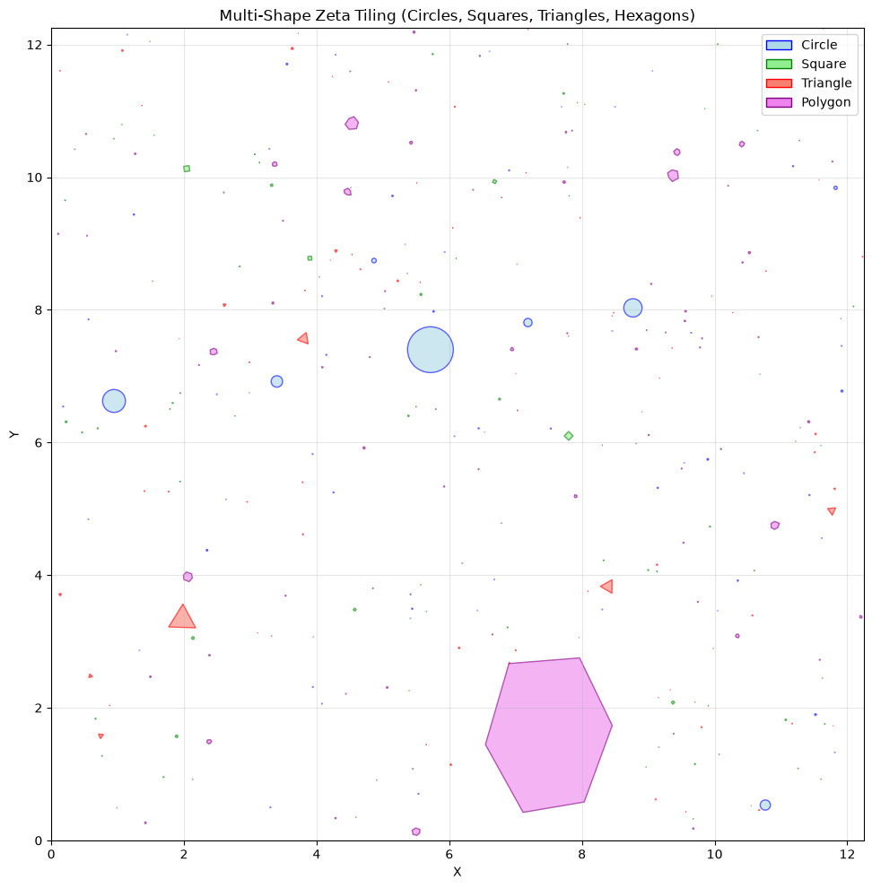
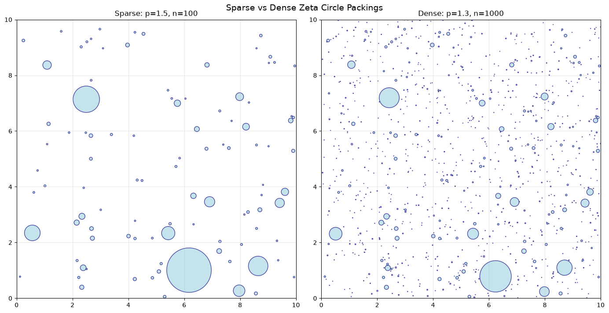

<!-- Generated by scripts/render_notebooks.py from the notebook named in the frontmatter. Do not edit: edit the .ipynb and re-run the script. -->

# Chapter 4: Zeta Space Tilings

!!! info "Jupyter notebook"

    This page was rendered from the stored outputs of `4_zeta_space.ipynb` as of 2026-10-24; it is not executed at build time.

    [View on GitHub](https://github.com/tyson-swetnam/fractal-notebooks/blob/main/docs/notebooks/foundations/4_zeta_space.ipynb) · [Open in nbviewer](https://nbviewer.org/github/tyson-swetnam/fractal-notebooks/blob/main/docs/notebooks/foundations/4_zeta_space.ipynb) · [Open in Colab](https://colab.research.google.com/github/tyson-swetnam/fractal-notebooks/blob/main/docs/notebooks/foundations/4_zeta_space.ipynb) · [Raw .ipynb](https://raw.githubusercontent.com/tyson-swetnam/fractal-notebooks/main/docs/notebooks/foundations/4_zeta_space.ipynb)

    Kernel: Python 3 (ipykernel) · Environment: environments/fractal-foundations-gpu.yml (runs on CPU: numpy, scipy, matplotlib) · Companion page: [foundations/history/#16-modern-developments-complex-dimensions-and-spectral-geometry](https://tyson-swetnam.github.io/fractal-notebooks/foundations/history/#16-modern-developments-complex-dimensions-and-spectral-geometry)

This notebook explores iterative tiling patterns based on the **Riemann zeta function** and power-law area distributions. These tilings demonstrate how self-similar fractal properties emerge from number-theoretic foundations.

**Topics covered:**
- The Riemann zeta function and power-law distributions
- Area-based tiling with $A_i = A_0 / i^p$
- Multi-shape tilings (circles, squares, triangles, polygons)
- Connection to fractal packing and Apollonian gaskets


```python
import numpy as np
import matplotlib.pyplot as plt
import matplotlib.patches as patches
from scipy.special import zeta
import random
import warnings
warnings.filterwarnings('ignore')

# Set default figure style
plt.rcParams['figure.figsize'] = [10, 8]
plt.rcParams['figure.dpi'] = 100
```

## 4.1 The Riemann Zeta Function

The **Riemann zeta function** is defined for $\text{Re}(s) > 1$ as:

$$\zeta(s) = \sum_{n=1}^{\infty} \frac{1}{n^s}$$

This function converges for $s > 1$ and provides a natural framework for generating power-law distributions. Famous values include:

- $\zeta(2) = \frac{\pi^2}{6} \approx 1.6449$ (Basel problem)
- $\zeta(3) \approx 1.2021$ (Apéry's constant)
- $\zeta(4) = \frac{\pi^4}{90} \approx 1.0823$

### Power-Law Area Distribution

We use the zeta function to generate a sequence of decreasing areas:

$$A_i = \frac{A_0}{i^p}$$

where $A_0$ is the initial area and $p > 1$ is the exponent. The total area sums to:

$$\sum_{i=1}^{\infty} A_i = A_0 \cdot \zeta(p)$$


```python
# Visualize the zeta function
fig, axes = plt.subplots(1, 2, figsize=(14, 5))

# Plot zeta(s) for real s > 1
s_values = np.linspace(1.01, 5, 200)
zeta_values = [zeta(s) for s in s_values]

axes[0].plot(s_values, zeta_values, 'b-', lw=2)
axes[0].axhline(y=1, color='gray', linestyle='--', alpha=0.5)
axes[0].set_xlabel('s', fontsize=12)
axes[0].set_ylabel(r'$\zeta(s)$', fontsize=12)
axes[0].set_title(r'Riemann Zeta Function $\zeta(s) = \sum_{n=1}^{\infty} n^{-s}$', fontsize=12)
axes[0].grid(True, alpha=0.3)
axes[0].set_xlim(1, 5)
axes[0].set_ylim(0.5, 10)

# Mark special values
special = [(2, np.pi**2/6, r'$\zeta(2) = \pi^2/6$'), 
           (3, zeta(3), r'$\zeta(3)$'),
           (4, np.pi**4/90, r'$\zeta(4) = \pi^4/90$')]
for s, val, label in special:
    axes[0].plot(s, val, 'ro', markersize=8)
    axes[0].annotate(label, (s, val), textcoords="offset points", 
                     xytext=(10, 10), fontsize=10)

# Plot power-law area distributions
i_values = np.arange(1, 51)
for p in [1.2, 1.5, 2.0, 3.0]:
    areas = 1 / i_values**p
    axes[1].semilogy(i_values, areas, 'o-', markersize=3, label=f'p = {p}')

axes[1].set_xlabel('Shape index i', fontsize=12)
axes[1].set_ylabel(r'Area $A_i = A_0/i^p$', fontsize=12)
axes[1].set_title('Power-Law Area Distributions', fontsize=12)
axes[1].legend()
axes[1].grid(True, alpha=0.3)

plt.tight_layout()
plt.show()

# Print some zeta values
print("Riemann Zeta Function Values:")
print(f"  ζ(2) = π²/6 = {np.pi**2/6:.6f}")
print(f"  ζ(3) = {zeta(3):.6f} (Apéry's constant)")
print(f"  ζ(4) = π⁴/90 = {np.pi**4/90:.6f}")
```





```text
Riemann Zeta Function Values:
  ζ(2) = π²/6 = 1.644934
  ζ(3) = 1.202057 (Apéry's constant)
  ζ(4) = π⁴/90 = 1.082323
```

## 4.2 Single-Shape Zeta Tilings

We generate tilings by placing shapes with areas following the zeta distribution. Each shape $i$ has:

- **Area**: $A_i = A_0 / i^p$
- **For circles**: radius $r_i = \sqrt{A_i / \pi}$
- **For squares/triangles**: side length $s_i = \sqrt{A_i}$

Shapes are placed randomly without overlap, creating a packing that exhibits self-similar properties.


```python
def generate_tiling(
    shape_type='Circle',
    A_plane=100.0,
    A0=1.0,
    p=2.0,
    n_shapes=200,
    max_particle_size=5.0,
    random_orientation=True,
    seed=42
):
    """Generate a zeta-distributed tiling with a single shape type.
    
    Parameters:
    - shape_type: 'Circle', 'Square', or 'Triangle'
    - A_plane: Total area of the plane
    - A0: Initial area (largest shape)
    - p: Zeta exponent (must be > 1 for convergence)
    - n_shapes: Maximum number of shapes to place
    - max_particle_size: Maximum size constraint
    - random_orientation: Whether to randomly rotate shapes
    - seed: Random seed for reproducibility
    """
    random.seed(seed)
    np.random.seed(seed)
    
    # Generate areas: A_i = A0 / i^p
    areas = []
    i = 1
    while len(areas) < n_shapes:
        area = A0 / (i**p)
        if area <= 0:
            break
        size = np.sqrt(area / np.pi) if shape_type == 'Circle' else np.sqrt(area)
        if size <= max_particle_size:
            areas.append(area)
        i += 1

    # Compute dimensions
    if shape_type == 'Circle':
        sizes = [np.sqrt(area / np.pi) for area in areas]  # Radii
    else:
        sizes = [np.sqrt(area) for area in areas]  # Side lengths

    # Define plane dimensions
    L = np.sqrt(A_plane)

    # Store positions
    positions = []

    def is_overlapping(x_new, y_new, size_new, positions):
        for x, y, size, angle in positions:
            if shape_type == 'Circle':
                distance = np.hypot(x_new - x, y_new - y)
                if distance < (size_new + size):
                    return True
            else:
                distance = np.hypot(x_new - x, y_new - y)
                radius_new = size_new * np.sqrt(2) / 2
                radius = size * np.sqrt(2) / 2
                if distance < (radius_new + radius):
                    return True
        return False

    # Place shapes without overlap
    for size in sizes:
        max_attempts = 1000
        for attempt in range(max_attempts):
            x = random.uniform(size, L - size)
            y = random.uniform(size, L - size)
            angle = random.uniform(0, 360) if random_orientation else 0
            if not is_overlapping(x, y, size, positions):
                positions.append((x, y, size, angle))
                break

    return positions, L, areas


def plot_tiling(positions, L, shape_type, title_suffix=''):
    """Plot a tiling given positions and plane size."""
    fig, ax = plt.subplots(figsize=(8, 8))
    
    colors = {'Circle': ('blue', 'lightblue'),
              'Square': ('green', 'lightgreen'),
              'Triangle': ('red', 'salmon')}
    edge, face = colors.get(shape_type, ('black', 'gray'))
    
    for x, y, size, angle in positions:
        if shape_type == 'Circle':
            shape = plt.Circle((x, y), size, edgecolor=edge, facecolor=face, alpha=0.6)
        elif shape_type == 'Square':
            shape = patches.Rectangle(
                (x - size/2, y - size/2), size, size,
                edgecolor=edge, facecolor=face, alpha=0.6
            )
            transform = plt.matplotlib.transforms.Affine2D().rotate_deg_around(x, y, angle)
            shape.set_transform(transform + ax.transData)
        elif shape_type == 'Triangle':
            h = size * np.sqrt(3) / 2
            points = np.array([
                [x, y + 2*h/3],
                [x - size/2, y - h/3],
                [x + size/2, y - h/3]
            ])
            shape = patches.Polygon(points, closed=True, 
                                    edgecolor=edge, facecolor=face, alpha=0.6)
            transform = plt.matplotlib.transforms.Affine2D().rotate_deg_around(x, y, angle)
            shape.set_transform(transform + ax.transData)
        
        ax.add_patch(shape)

    ax.set_xlim(0, L)
    ax.set_ylim(0, L)
    ax.set_aspect('equal', 'box')
    ax.set_title(f'Zeta Tiling: {shape_type}s{title_suffix}', fontsize=12)
    ax.set_xlabel('X')
    ax.set_ylabel('Y')
    ax.grid(True, alpha=0.3)
    return fig, ax


# Generate and plot tilings for each shape type
fig, axes = plt.subplots(1, 3, figsize=(15, 5))

for ax, shape_type in zip(axes, ['Circle', 'Square', 'Triangle']):
    positions, L, areas = generate_tiling(
        shape_type=shape_type,
        A_plane=100.0,
        A0=1.0,
        p=2.0,
        n_shapes=200,
        max_particle_size=5.0,
        seed=42
    )
    
    colors = {'Circle': ('blue', 'lightblue'),
              'Square': ('green', 'lightgreen'),
              'Triangle': ('red', 'salmon')}
    edge, face = colors[shape_type]
    
    for x, y, size, angle in positions:
        if shape_type == 'Circle':
            shape = plt.Circle((x, y), size, edgecolor=edge, facecolor=face, alpha=0.6)
        elif shape_type == 'Square':
            shape = patches.Rectangle(
                (x - size/2, y - size/2), size, size,
                edgecolor=edge, facecolor=face, alpha=0.6
            )
            transform = plt.matplotlib.transforms.Affine2D().rotate_deg_around(x, y, angle)
            shape.set_transform(transform + ax.transData)
        elif shape_type == 'Triangle':
            h = size * np.sqrt(3) / 2
            points = np.array([
                [x, y + 2*h/3],
                [x - size/2, y - h/3],
                [x + size/2, y - h/3]
            ])
            shape = patches.Polygon(points, closed=True, 
                                    edgecolor=edge, facecolor=face, alpha=0.6)
            transform = plt.matplotlib.transforms.Affine2D().rotate_deg_around(x, y, angle)
            shape.set_transform(transform + ax.transData)
        
        ax.add_patch(shape)
    
    ax.set_xlim(0, L)
    ax.set_ylim(0, L)
    ax.set_aspect('equal', 'box')
    ax.set_title(f'{shape_type}s (n={len(positions)})', fontsize=12)
    ax.grid(True, alpha=0.3)

plt.suptitle(r'Single-Shape Zeta Tilings ($p = 2.0$, $A_0 = 1.0$)', fontsize=14)
plt.tight_layout()
plt.show()

print(f"Total area covered (theoretical): A₀ · ζ(2) = {1.0 * zeta(2):.4f}")
```





```text
Total area covered (theoretical): A₀ · ζ(2) = 1.6449
```

## 4.3 Effect of Exponent p

The exponent $p$ controls the size distribution:

- **$p \to 1^+$**: Slower decay, more similar-sized shapes, higher total area
- **$p = 2$**: Quadratic decay (Basel problem distribution)
- **$p > 2$**: Faster decay, more small shapes dominate


```python
# Compare different exponents
fig, axes = plt.subplots(2, 2, figsize=(12, 12))
axes = axes.flatten()

exponents = [1.2, 1.5, 2.0, 3.0]

for ax, p in zip(axes, exponents):
    positions, L, areas = generate_tiling(
        shape_type='Circle',
        A_plane=100.0,
        A0=1.0,
        p=p,
        n_shapes=500,
        max_particle_size=5.0,
        seed=42
    )
    
    for x, y, size, angle in positions:
        circle = plt.Circle((x, y), size, edgecolor='blue', 
                            facecolor='lightblue', alpha=0.6)
        ax.add_patch(circle)
    
    ax.set_xlim(0, L)
    ax.set_ylim(0, L)
    ax.set_aspect('equal', 'box')
    ax.set_title(f'p = {p}, ζ(p) = {zeta(p):.3f}, n = {len(positions)}', fontsize=11)
    ax.grid(True, alpha=0.3)

plt.suptitle('Effect of Exponent p on Circle Tilings', fontsize=14)
plt.tight_layout()
plt.show()
```





## 4.4 Multi-Shape Zeta Tilings

We can extend the tiling to include multiple shape types, randomly selecting the shape for each area. This creates more complex packings reminiscent of natural patterns.


```python
def generate_polygon(center, avg_radius, irregularity, spikiness, num_vertices):
    """Generate a random polygon with specified properties."""
    irregularity = np.clip(irregularity, 0, 1) * 2 * np.pi / num_vertices
    spikiness = np.clip(spikiness, 0, 1) * avg_radius

    # Generate angle steps
    angle_steps = []
    lower = (2 * np.pi / num_vertices) - irregularity
    upper = (2 * np.pi / num_vertices) + irregularity
    total = 0
    for _ in range(num_vertices):
        step = random.uniform(lower, upper)
        angle_steps.append(step)
        total += step

    # Normalize to 2π
    k = total / (2 * np.pi)
    angle_steps = [s / k for s in angle_steps]

    # Generate points
    points = []
    angle = random.uniform(0, 2 * np.pi)
    for i in range(num_vertices):
        r_i = np.clip(random.gauss(avg_radius, spikiness), 0, 2 * avg_radius)
        x = center[0] + r_i * np.cos(angle)
        y = center[1] + r_i * np.sin(angle)
        points.append((x, y))
        angle += angle_steps[i]

    return points


def generate_multi_shape_tiling(
    shape_types=['Circle', 'Square', 'Triangle', 'Polygon'],
    A_plane=100.0,
    A0=1.0,
    p=2.0,
    n_shapes=200,
    max_particle_size=5.0,
    random_orientation=True,
    polygon_sides=6,
    irregularity=0.0,
    spikiness=0.0,
    seed=42
):
    """Generate a zeta-distributed tiling with multiple shape types."""
    random.seed(seed)
    np.random.seed(seed)
    
    # Generate areas
    areas = []
    i = 1
    while len(areas) < n_shapes:
        area = A0 / (i**p)
        if area <= 0:
            break
        size = np.sqrt(area / np.pi)
        if size <= max_particle_size:
            areas.append(area)
        i += 1
    
    # Shuffle and assign shapes
    random.shuffle(areas)
    shape_assignments = []
    sizes_list = []
    
    for area in areas:
        shape = random.choice(shape_types)
        if shape == 'Circle':
            size = np.sqrt(area / np.pi)
        else:
            size = np.sqrt(area)
        sizes_list.append(size)
        shape_assignments.append(shape)
    
    L = np.sqrt(A_plane)
    positions = []
    
    def is_overlapping(x_new, y_new, size_new, shape_new):
        if shape_new == 'Circle':
            radius_new = size_new
        elif shape_new == 'Polygon':
            radius_new = size_new
        else:
            radius_new = size_new * np.sqrt(2) / 2
            
        for x, y, size, shape, angle, params in positions:
            if shape == 'Circle':
                radius = size
            elif shape == 'Polygon':
                radius = size
            else:
                radius = size * np.sqrt(2) / 2
            distance = np.hypot(x_new - x, y_new - y)
            if distance < (radius_new + radius):
                return True
        return False
    
    # Place shapes
    for size, shape_type in zip(sizes_list, shape_assignments):
        max_attempts = 1000
        for attempt in range(max_attempts):
            x = random.uniform(size, L - size)
            y = random.uniform(size, L - size)
            angle = random.uniform(0, 360) if random_orientation else 0
            if not is_overlapping(x, y, size, shape_type):
                params = {'num_vertices': polygon_sides, 
                         'irregularity': irregularity,
                         'spikiness': spikiness} if shape_type == 'Polygon' else None
                positions.append((x, y, size, shape_type, angle, params))
                break
    
    return positions, L


# Generate multi-shape tiling
positions, L = generate_multi_shape_tiling(
    shape_types=['Circle', 'Square', 'Triangle', 'Polygon'],
    A_plane=150.0,
    A0=1.5,
    p=2.0,
    n_shapes=300,
    max_particle_size=5.0,
    polygon_sides=6,
    irregularity=0.2,
    spikiness=0.1,
    seed=42
)

# Plot
fig, ax = plt.subplots(figsize=(10, 10))

colors = {
    'Circle': ('blue', 'lightblue'),
    'Square': ('green', 'lightgreen'),
    'Triangle': ('red', 'salmon'),
    'Polygon': ('purple', 'violet')
}

for x, y, size, shape_type, angle, params in positions:
    edge, face = colors[shape_type]
    
    if shape_type == 'Circle':
        shape = plt.Circle((x, y), size, edgecolor=edge, facecolor=face, alpha=0.6)
        ax.add_patch(shape)
    elif shape_type == 'Square':
        shape = patches.Rectangle(
            (x - size/2, y - size/2), size, size,
            edgecolor=edge, facecolor=face, alpha=0.6
        )
        transform = plt.matplotlib.transforms.Affine2D().rotate_deg_around(x, y, angle)
        shape.set_transform(transform + ax.transData)
        ax.add_patch(shape)
    elif shape_type == 'Triangle':
        h = size * np.sqrt(3) / 2
        points = np.array([
            [x, y + 2*h/3],
            [x - size/2, y - h/3],
            [x + size/2, y - h/3]
        ])
        shape = patches.Polygon(points, closed=True, 
                                edgecolor=edge, facecolor=face, alpha=0.6)
        transform = plt.matplotlib.transforms.Affine2D().rotate_deg_around(x, y, angle)
        shape.set_transform(transform + ax.transData)
        ax.add_patch(shape)
    elif shape_type == 'Polygon':
        pts = generate_polygon(
            center=(x, y),
            avg_radius=size,
            irregularity=params['irregularity'],
            spikiness=params['spikiness'],
            num_vertices=params['num_vertices']
        )
        shape = patches.Polygon(pts, closed=True, 
                                edgecolor=edge, facecolor=face, alpha=0.6)
        ax.add_patch(shape)

ax.set_xlim(0, L)
ax.set_ylim(0, L)
ax.set_aspect('equal', 'box')
ax.set_title('Multi-Shape Zeta Tiling (Circles, Squares, Triangles, Hexagons)', fontsize=12)
ax.set_xlabel('X')
ax.set_ylabel('Y')
ax.grid(True, alpha=0.3)

# Legend
from matplotlib.patches import Patch
legend_elements = [Patch(facecolor=colors[s][1], edgecolor=colors[s][0], label=s) 
                   for s in ['Circle', 'Square', 'Triangle', 'Polygon']]
ax.legend(handles=legend_elements, loc='upper right')

plt.tight_layout()
plt.show()

# Count shapes
shape_counts = {}
for _, _, _, shape_type, _, _ in positions:
    shape_counts[shape_type] = shape_counts.get(shape_type, 0) + 1
print(f"Shape counts: {shape_counts}")
print(f"Total shapes placed: {len(positions)}")
```





```text
Shape counts: {'Polygon': 78, 'Square': 76, 'Triangle': 76, 'Circle': 70}
Total shapes placed: 300
```

## 4.5 Connection to Apollonian Gaskets

The zeta tilings share properties with **Apollonian gaskets**, which are fractal packings of circles where each new circle is tangent to three existing ones.

**Key similarities:**
- Power-law size distribution
- Self-similar structure at multiple scales
- Packing efficiency increases with more small shapes

**Differences:**
- Apollonian gaskets have strict tangency constraints
- Zeta tilings use random placement with non-overlap
- Zeta distribution is analytically tractable via $\zeta(p)$


```python
# Generate a denser packing approaching Apollonian-like structure
fig, axes = plt.subplots(1, 2, figsize=(14, 7))

# Sparse packing
positions_sparse, L = generate_tiling(
    shape_type='Circle',
    A_plane=100.0,
    A0=2.0,
    p=1.5,
    n_shapes=100,
    max_particle_size=10.0,
    seed=42
)[:2]

for x, y, size, _ in positions_sparse:
    circle = plt.Circle((x, y), size, edgecolor='navy', 
                        facecolor='lightblue', alpha=0.7)
    axes[0].add_patch(circle)

axes[0].set_xlim(0, L)
axes[0].set_ylim(0, L)
axes[0].set_aspect('equal', 'box')
axes[0].set_title(f'Sparse: p=1.5, n={len(positions_sparse)}', fontsize=12)
axes[0].grid(True, alpha=0.3)

# Dense packing
positions_dense, L = generate_tiling(
    shape_type='Circle',
    A_plane=100.0,
    A0=1.0,
    p=1.3,
    n_shapes=1000,
    max_particle_size=5.0,
    seed=42
)[:2]

for x, y, size, _ in positions_dense:
    circle = plt.Circle((x, y), size, edgecolor='navy', 
                        facecolor='lightblue', alpha=0.7)
    axes[1].add_patch(circle)

axes[1].set_xlim(0, L)
axes[1].set_ylim(0, L)
axes[1].set_aspect('equal', 'box')
axes[1].set_title(f'Dense: p=1.3, n={len(positions_dense)}', fontsize=12)
axes[1].grid(True, alpha=0.3)

plt.suptitle('Sparse vs Dense Zeta Circle Packings', fontsize=14)
plt.tight_layout()
plt.show()
```





## Summary

| Parameter | Effect |
|-----------|--------|
| $p$ (exponent) | Controls size decay rate; smaller $p$ → more large shapes |
| $A_0$ (initial area) | Sets the scale of the largest shape |
| $\zeta(p)$ | Total area factor; diverges as $p \to 1^+$ |
| Shape types | Circles pack most efficiently; polygons add complexity |

### Key Results

1. The Riemann zeta function provides a natural power-law distribution for fractal-like tilings
2. Exponent $p$ controls the self-similarity: smaller $p$ creates more scale-invariant patterns
3. Multi-shape tilings exhibit richer visual complexity while maintaining mathematical structure

## Further Reading

- Mandelbrot, B. B. *The Fractal Geometry of Nature*. W. H. Freeman, 1982.
- Graham, R. L., et al. "Apollonian Circle Packings: Geometry and Group Theory." *Discrete & Computational Geometry*, 2003.
- Edwards, H. M. *Riemann's Zeta Function*. Dover, 2001.

**Next:** See `zeta_3d.ipynb` for 3D zeta sphere packings and visualizations.
