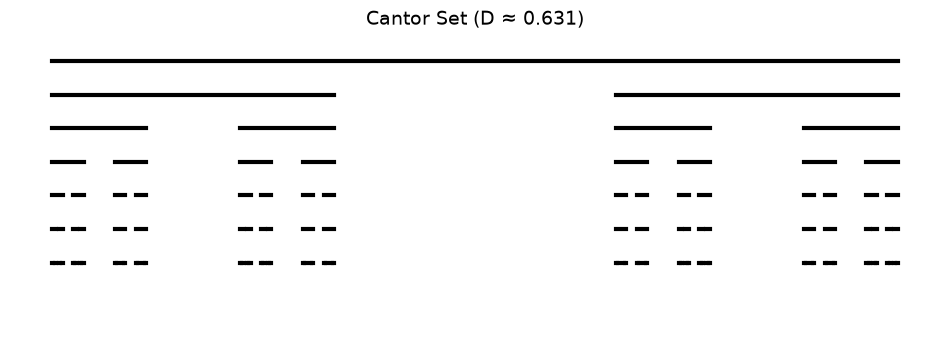
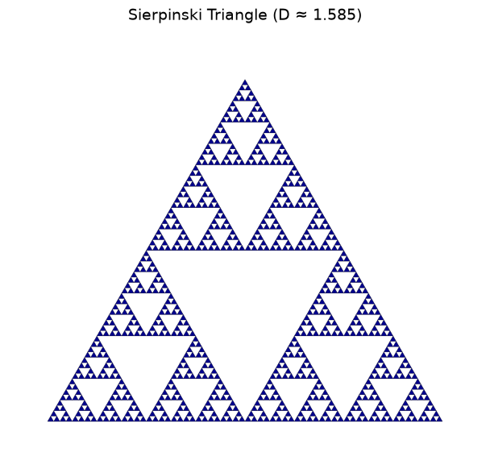
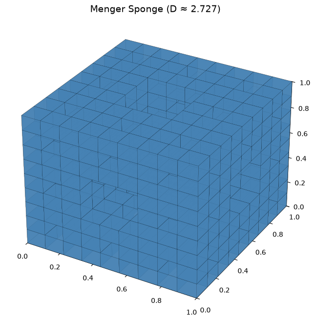
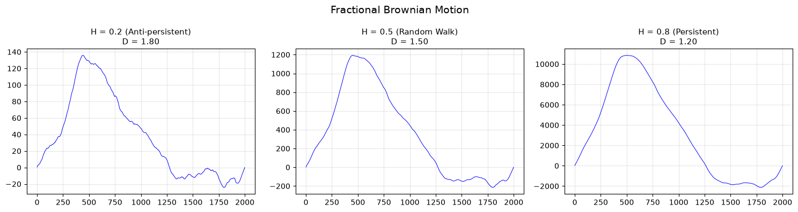

<!-- Generated by scripts/render_notebooks.py from the notebook named in the frontmatter. Do not edit: edit the .ipynb and re-run the script. -->

# Foundations of Fractal Geometry

!!! info "Jupyter notebook"

    This page was rendered from the stored outputs of `fractals.ipynb` as of 2026-10-24; it is not executed at build time.

    [View on GitHub](https://github.com/tyson-swetnam/fractal-notebooks/blob/main/docs/notebooks/foundations/fractals.ipynb) · [Open in nbviewer](https://nbviewer.org/github/tyson-swetnam/fractal-notebooks/blob/main/docs/notebooks/foundations/fractals.ipynb) · [Open in Colab](https://colab.research.google.com/github/tyson-swetnam/fractal-notebooks/blob/main/docs/notebooks/foundations/fractals.ipynb) · [Raw .ipynb](https://raw.githubusercontent.com/tyson-swetnam/fractal-notebooks/main/docs/notebooks/foundations/fractals.ipynb)

    Kernel: Python 3 · Environment: environments/fractal-foundations-gpu.yml (runs on CPU: numpy, matplotlib) · Companion page: [foundations/](https://tyson-swetnam.github.io/fractal-notebooks/foundations/)

This notebook provides an overview of the Foundations section, with quick demonstrations and links to detailed notebooks.

## Notebook Series

The Foundations section is organized into four chapters corresponding to the documentation:

| Notebook | Topics | Key Concepts |
|----------|--------|-------------|
| **[1_history.ipynb](1_history.md)** | History of Fractal Mathematics | Cantor, Koch, Sierpinski, Julia, Mandelbrot, Weierstrass |
| **[2_mathematics.ipynb](2_mathematics.md)** | Mathematical Foundations | Box-counting, DBC, power laws, Hurst exponent, lacunarity |
| **[3_dimensionality.ipynb](3_dimensionality.md)** | Fractal Dimensionality (1D-4D) | Pink noise, fBm, Mandelbrot/Julia, Menger, DLA |

---

## Quick Start: Essential Fractals

Below are minimal examples of key fractal types. See the specialized notebooks for detailed explanations and analyses.


```python
import numpy as np
import matplotlib.pyplot as plt
from matplotlib.patches import Polygon
from matplotlib.collections import PatchCollection

plt.rcParams['figure.figsize'] = [12, 8]
plt.rcParams['figure.dpi'] = 100
```

## 1D Fractals: Cantor Set

The Cantor set (1883) iteratively removes the middle third of each interval.

**Dimension:** $D = \frac{\log 2}{\log 3} \approx 0.631$

See [1_history.ipynb](1_history.md) for detailed exploration.


```python
def cantor_set(ax, x, y, length, depth, max_depth):
    """Draw Cantor set recursively."""
    ax.plot([x, x + length], [y, y], color='black', lw=3)
    if depth < max_depth:
        new_length = length / 3
        cantor_set(ax, x, y - 0.12, new_length, depth + 1, max_depth)
        cantor_set(ax, x + 2 * new_length, y - 0.12, new_length, depth + 1, max_depth)

fig, ax = plt.subplots(figsize=(12, 4))
cantor_set(ax, 0, 1, 1, 0, 6)
ax.set_xlim(-0.05, 1.05)
ax.set_ylim(0, 1.1)
ax.set_title(f'Cantor Set (D ≈ {np.log(2)/np.log(3):.3f})', fontsize=14)
ax.axis('off')
plt.show()
```





## 2D Fractals: Sierpinski Triangle

The Sierpinski triangle (1915) removes the central triangle at each iteration.

**Dimension:** $D = \frac{\log 3}{\log 2} \approx 1.585$

See [1_history.ipynb](1_history.md) for construction details and [3_dimensionality.ipynb](3_dimensionality.md) for chaos game implementation.


```python
def sierpinski_triangle(ax, vertices, depth, patches):
    """Generate Sierpinski triangle."""
    if depth == 0:
        patches.append(Polygon(vertices, closed=True))
    else:
        midpoints = [(vertices[i] + vertices[(i + 1) % 3]) / 2 for i in range(3)]
        sierpinski_triangle(ax, np.array([vertices[0], midpoints[0], midpoints[2]]), depth-1, patches)
        sierpinski_triangle(ax, np.array([vertices[1], midpoints[1], midpoints[0]]), depth-1, patches)
        sierpinski_triangle(ax, np.array([vertices[2], midpoints[2], midpoints[1]]), depth-1, patches)

fig, ax = plt.subplots(figsize=(8, 7))
vertices = np.array([[0, 0], [1, 0], [0.5, np.sqrt(3)/2]])
patches = []
sierpinski_triangle(ax, vertices, 6, patches)
collection = PatchCollection(patches, facecolor='darkblue', edgecolor='black', linewidth=0.2)
ax.add_collection(collection)
ax.set_xlim(-0.1, 1.1)
ax.set_ylim(-0.1, 1)
ax.set_aspect('equal')
ax.set_title(f'Sierpinski Triangle (D ≈ {np.log(3)/np.log(2):.3f})', fontsize=14)
ax.axis('off')
plt.show()
```





## 3D Fractals: Menger Sponge

The Menger sponge (1926) is the 3D analog of the Sierpinski carpet.

**Dimension:** $D = \frac{\log 20}{\log 3} \approx 2.727$

See [3_dimensionality.ipynb](3_dimensionality.md) for 3D visualization.


```python
from mpl_toolkits.mplot3d.art3d import Poly3DCollection

def menger_cubes(x, y, z, size, depth):
    """Generate Menger sponge cube positions."""
    if depth == 0:
        return [(x, y, z, size)]
    new_size = size / 3
    cubes = []
    for dx in range(3):
        for dy in range(3):
            for dz in range(3):
                if (dx == 1) + (dy == 1) + (dz == 1) >= 2:
                    continue
                cubes.extend(menger_cubes(x + dx*new_size, y + dy*new_size, z + dz*new_size, new_size, depth-1))
    return cubes

def draw_cube(ax, x, y, z, size):
    v = np.array([[x, y, z], [x+size, y, z], [x+size, y+size, z], [x, y+size, z],
                  [x, y, z+size], [x+size, y, z+size], [x+size, y+size, z+size], [x, y+size, z+size]])
    faces = [[v[0],v[1],v[2],v[3]], [v[4],v[5],v[6],v[7]], [v[0],v[1],v[5],v[4]], 
             [v[2],v[3],v[7],v[6]], [v[1],v[2],v[6],v[5]], [v[0],v[3],v[7],v[4]]]
    ax.add_collection3d(Poly3DCollection(faces, facecolors='steelblue', linewidths=0.1, edgecolors='black', alpha=0.8))

fig = plt.figure(figsize=(10, 8))
ax = fig.add_subplot(111, projection='3d')
for x, y, z, size in menger_cubes(0, 0, 0, 1, 2):
    draw_cube(ax, x, y, z, size)
ax.set_xlim(0, 1); ax.set_ylim(0, 1); ax.set_zlim(0, 1)
ax.set_title(f'Menger Sponge (D ≈ {np.log(20)/np.log(3):.3f})', fontsize=14)
plt.show()
```





## Self-Affine Fractals: Fractional Brownian Motion

Fractional Brownian motion (fBm) is parameterized by the Hurst exponent $H$:
- $H < 0.5$: Anti-persistent (mean-reverting)
- $H = 0.5$: Standard Brownian motion
- $H > 0.5$: Persistent (trending)

**Dimension:** $D = 2 - H$

See [2_mathematics.ipynb](2_mathematics.md) for Hurst exponent estimation and [3_dimensionality.ipynb](3_dimensionality.md) for detailed analysis.


```python
def generate_fbm(n, H, seed=42):
    """Generate fractional Brownian motion."""
    np.random.seed(seed)
    freqs = np.fft.rfftfreq(n)
    freqs[0] = 1e-10
    spectrum = 1.0 / np.abs(freqs) ** ((2*H + 1) / 2)
    spectrum[0] = 0
    phases = np.exp(2j * np.pi * np.random.rand(len(freqs)))
    return np.cumsum(np.fft.irfft(spectrum * phases, n))

fig, axes = plt.subplots(1, 3, figsize=(15, 4))
for i, H in enumerate([0.2, 0.5, 0.8]):
    fbm = generate_fbm(2000, H)
    axes[i].plot(fbm, 'b-', lw=0.7)
    behavior = 'Anti-persistent' if H < 0.5 else ('Persistent' if H > 0.5 else 'Random Walk')
    axes[i].set_title(f'H = {H} ({behavior})\nD = {2-H:.2f}', fontsize=11)
    axes[i].grid(True, alpha=0.3)
fig.suptitle('Fractional Brownian Motion', fontsize=14)
plt.tight_layout()
plt.show()
```





## Fractal Dimension Reference

| Fractal | N copies | Scale r | Dimension D |
|---------|----------|---------|-------------|
| Cantor Set | 2 | 1/3 | 0.631 |
| Koch Curve | 4 | 1/3 | 1.262 |
| Sierpinski Triangle | 3 | 1/2 | 1.585 |
| Sierpinski Carpet | 8 | 1/3 | 1.893 |
| Menger Sponge | 20 | 1/3 | 2.727 |

**Formula:** $D = \frac{\log N}{\log(1/r)}$


```python
print("Self-Similar Fractal Dimensions")
print("=" * 50)
fractals = [
    ("Cantor Set", 2, 3),
    ("Koch Curve", 4, 3),
    ("Sierpinski Triangle", 3, 2),
    ("Sierpinski Carpet", 8, 3),
    ("Menger Sponge", 20, 3),
]
for name, N, inv_r in fractals:
    D = np.log(N) / np.log(inv_r)
    print(f"{name:<22} D = log({N})/log({inv_r}) = {D:.4f}")
```

```text
Self-Similar Fractal Dimensions
==================================================
Cantor Set             D = log(2)/log(3) = 0.6309
Koch Curve             D = log(4)/log(3) = 1.2619
Sierpinski Triangle    D = log(3)/log(2) = 1.5850
Sierpinski Carpet      D = log(8)/log(3) = 1.8928
Menger Sponge          D = log(20)/log(3) = 2.7268
```

## Next Steps

For deeper exploration:

1. **[1_history.ipynb](1_history.md)** - Historical development: Cantor, Koch, Sierpinski, Julia, Mandelbrot, Weierstrass function

2. **[2_mathematics.ipynb](2_mathematics.md)** - Measurement methods: box-counting, differential box-counting, power law analysis, Hurst exponent, lacunarity

3. **[3_dimensionality.ipynb](3_dimensionality.md)** - Examples across dimensions: 1D (pink noise, fBm), 2D (Mandelbrot/Julia, fBs), 3D (Menger, DLA), 4D (growth dynamics)

---

**Related sections:**
- `biological-geometry/` - Branching architectures, vascular networks, L-systems
- `metabolic-scaling/` - West-Brown-Enquist theory, allometric scaling
